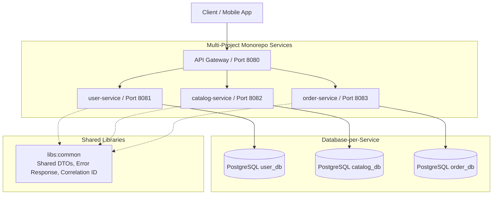

# Swiggy/Zomato Mini Delivery Platform 🍕🚀

A production-grade, distributed food-delivery platform built with **Java 21 (Virtual Threads)**, **Spring Boot 3.4**, **PostgreSQL + Flyway (Database-per-Service)**, **Redis**, **Apache Kafka**, **WebSocket (STOMP)**, **Testcontainers**, **Resilience4j**, and deployed to **AWS with Terraform**.

---

## Target Microservices Architecture



---

## Repository Layout (Multi-Project Gradle Monorepo)

```text
project-backend-2/
├── .github/workflows/       # CI/CD: Automated builds and Testcontainers tests
├── docs/
│   ├── adr/                 # Architecture Decision Records (ADR-001, ADR-002, ...)
│   └── glossary.md          # Living glossary of distributed systems concepts
├── infra/
│   └── docker/
│       ├── docker-compose.yml   # Multi-service infrastructure (PostgreSQL 16)
│       └── init-databases.sh    # Database-per-service auto-provisioning
├── libs/
│   └── common/                  # Shared library: ApiResponse<T>, ErrorResponse, CorrelationFilter
├── services/
│   ├── user-service/            # Port 8081, user_db (Auth, Customer, Rider, Restaurant roles)
│   ├── catalog-service/         # Port 8082, catalog_db (Restaurants, Menus, Items, Pricing)
│   └── order-service/           # Port 8083, order_db (Order lifecycle, State Machine, Outbox)
├── build.gradle.kts             # Root Gradle build script with subproject conventions
├── settings.gradle.kts          # Subproject inclusion
└── README.md
```

---

## Local Development Prerequisites
- **Java 21 LTS**
- **Docker Desktop** (running for Testcontainers & Compose)
- **Gradle Wrapper** (`./gradlew`)

---

## Running the Platform Locally

### 1. Start Local Infrastructure
```bash
docker compose -f infra/docker/docker-compose.yml up -d
```

### 2. Build and Test All Microservices
```bash
./gradlew test
```

### 3. Run a Specific Microservice
```bash
./gradlew :services:user-service:bootRun
./gradlew :services:catalog-service:bootRun
./gradlew :services:order-service:bootRun
```

---

## Stage Progress & What I Learned

### Stage 0: Microservices Setup & Foundation
- **Concepts Mastered:**
  - Multi-Project Gradle Monorepo setup (`ADR-001`).
  - Database-per-service isolation with PostgreSQL init scripts.
  - Java 21 Virtual Threads (`Project Loom`) across independent microservices (`ADR-002`).
  - In-code decision tagging (`DECISION`, `ALTERNATIVES`, `TRADE-OFF`, `INVARIANT`, `SIMPLIFICATION`).
