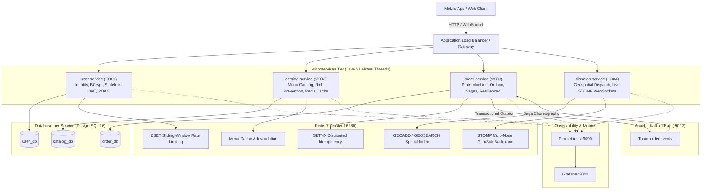

# Swiggy/Zomato Mini Delivery Platform 🍕🚀

A production-grade, distributed food-delivery platform built with **Java 21 (Virtual Threads)**, **Spring Boot 3.4**, **PostgreSQL + Flyway (Database-per-Service)**, **Redis 7**, **Apache Kafka (KRaft)**, **WebSocket (STOMP)**, **Resilience4j**, **OpenTelemetry**, and deployed to **AWS with Terraform**.

All 7 architectural stages (Stage 0 to Stage 6) are 100% implemented, tested with real Testcontainers suites, documented with ADRs, and ready for production.

---

## Architecture Overview



---

## Architectural Stages & Roadmap

| Stage | Milestone | Highlights | Status | Key ADRs |
| :--- | :--- | :--- | :--- | :--- |
| **Stage 0** | **Setup & Foundation** | Java 21, Gradle Monorepo, Multi-DB PostgreSQL 16 Compose, Shared `libs:common`, Testcontainers. | **DONE** ✅ | [ADR-001](docs/adr/ADR-001-modular-monolith-architecture.md), [ADR-002](docs/adr/ADR-002-build-tool-and-runtime-selection.md) |
| **Stage 1** | **Core Domain & Security** | BCrypt, Stateless JWT & RBAC, `@EntityGraph` N+1 fix, Order State Machine, `@Version` Optimistic Locking. | **DONE** ✅ | [ADR-003](docs/adr/ADR-003-stateless-jwt-authentication.md), [ADR-004](docs/adr/ADR-004-jpa-query-optimization-and-n-plus-1-prevention.md), [ADR-005](docs/adr/ADR-005-order-state-machine-concurrency.md) |
| **Stage 2** | **Redis Caching & State** | 15-min TTL menu cache with instant `@CacheEvict`, Redis Outage fallback, Redis ZSET rate limiting, SETNX idempotency, Redis GEO rider dispatching. | **DONE** ✅ | [ADR-006](docs/adr/ADR-006-redis-caching-and-invalidation.md), [ADR-007](docs/adr/ADR-007-distributed-rate-limiting-and-idempotency.md) |
| **Stage 3** | **Kafka & Event Sagas** | Transactional Outbox pattern, Kafka KRaft broker, Saga choreography, compensating cancel transactions, broker outage chaos resilience. | **DONE** ✅ | [ADR-008](docs/adr/ADR-008-transactional-outbox-and-sagas.md) |
| **Stage 4** | **Live Tracking & WebSockets** | STOMP WebSockets (`/ws-tracking`), Redis Pub/Sub backplane, dual REST & WebSocket telemetry ingress, live location broadcasting. | **DONE** ✅ | [ADR-009](docs/adr/ADR-009-realtime-tracking-websockets-redis-pubsub.md) |
| **Stage 5** | **Hardening & Observability** | Resilience4j Circuit Breaker & Retry with fallback, OpenTelemetry W3C traceparent propagation, MDC logging, Prometheus metrics, Grafana dashboards. | **DONE** ✅ | [ADR-010](docs/adr/ADR-010-resilience-and-observability.md) |
| **Stage 6** | **Cloud Deployment (AWS)** | Modular Terraform IaC (VPC, RDS Multi-AZ, ElastiCache Redis, MSK Kafka, ECS Fargate), ALB sticky sessions, Alpine Temurin Dockerfiles, AWS Budget alerts. | **DONE** ✅ | [ADR-011](docs/adr/ADR-011-cloud-infrastructure-aws-terraform.md) |

---

## Repository Layout

```text
project-backend-2/
├── docs/
│   ├── adr/                         # Architecture Decision Records (ADR-001 through ADR-011)
│   ├── progress.md                  # Detailed progress audit checklist across all stages
│   ├── stage-6-aws-deployment.md    # Production AWS deployment runbook
│   └── stage-*-summary.md           # Stage-by-stage architecture summaries
├── infra/
│   ├── docker/
│   │   ├── docker-compose.yml       # Multi-DB PostgreSQL 16, Redis 7, Kafka KRaft, Prometheus, Grafana
│   │   ├── init-databases.sh        # Automatically provisions user_db, catalog_db, order_db
│   │   └── prometheus/              # Prometheus scrape configs for Spring Boot Actuator
│   └── terraform/                   # AWS Production Infrastructure as Code
│       ├── modules/                 # vpc, rds, elasticache, msk, ecs
│       ├── main.tf                  # Root Terraform with AWS Budget alarms
│       └── variables.tf / outputs.tf
├── libs/
│   └── common/                      # Shared library: ApiResponse<T>, GlobalExceptionHandler, OpenTelemetry MDC
├── postman/                         # Production Postman Collection v2.1.0 and Local Environment
│   ├── swiggy-platform.postman_collection.json
│   ├── swiggy-local.postman_environment.json
│   └── README.md
├── services/
│   ├── user-service/                # Port 8081 | user_db (Auth, BCrypt, Stateless JWT, Rate Limiting)
│   ├── catalog-service/             # Port 8082 | catalog_db (Restaurants, Menus, EntityGraph, Redis Cache)
│   ├── order-service/               # Port 8083 | order_db (State Machine, Outbox, Saga, Resilience4j)
│   └── dispatch-service/            # Port 8084 | Redis (Geospatial Dispatch, STOMP WebSockets, Pub/Sub)
├── build.gradle.kts                 # Root Gradle build script with Java 21 conventions
├── settings.gradle.kts              # Subproject inclusion
└── README.md
```

---

## Prerequisites

Before running the platform, ensure the following are installed:
- **Java 21 LTS** (e.g., Eclipse Temurin 21)
- **Docker Desktop** (or Docker Engine + Docker Compose)
- **Git**

Verify your environment:
```bash
java -version    # OpenJDK 64-Bit Server VM (build 21.x)
docker --version # Docker version 24+
```

---

## Step-by-Step Guide to Run the System

### Step 1: Start Infrastructure Dependencies with Docker Compose
The platform provides a single Docker Compose file running PostgreSQL 16 (Multi-DB), Redis 7, Apache Kafka (KRaft mode), Prometheus, and Grafana:

```bash
cd infra/docker
docker compose up -d
```

Verify that all containers are healthy:
```bash
docker compose ps
```

| Container | Host Port | Purpose | Credentials / URL |
| :--- | :--- | :--- | :--- |
| `delivery-postgres` | `5432` | PostgreSQL 16 (`user_db`, `catalog_db`, `order_db`) | `delivery_user` / `delivery_pass` |
| `delivery-redis` | `6380` | Redis 7 (Caching, Rate Limiting, GEO, Pub/Sub) | `localhost:6380` |
| `delivery-kafka` | `9092` | Apache Kafka 3.6 (KRaft mode, Outbox stream) | `localhost:9092` |
| `delivery-prometheus` | `9090` | Prometheus Metrics Scraper | `http://localhost:9090` |
| `delivery-grafana` | `3000` | Grafana Dashboards | `http://localhost:3000` (`admin`/`admin`) |

---

### Step 2: Build & Verify All Microservices
From the project root, compile all modules and run the full Testcontainers test suite:

```bash
# Set Java 21 if using a local jvm path
export JAVA_HOME=/Users/adil/.jvm/current
export PATH="$JAVA_HOME/bin:$PATH"

# Run tests across all services (uses real Testcontainers)
./gradlew test

# Package production executable fat-jars
./gradlew bootJar
```

---

### Step 3: Run the Microservices

You can run each microservice using Gradle in separate terminal windows:

#### Terminal 1: User Service (:8081)
```bash
./gradlew :services:user-service:bootRun
```

#### Terminal 2: Catalog Service (:8082)
```bash
./gradlew :services:catalog-service:bootRun
```

#### Terminal 3: Order Service (:8083)
```bash
./gradlew :services:order-service:bootRun
```

#### Terminal 4: Dispatch Service (:8084)
```bash
./gradlew :services:dispatch-service:bootRun
```

---

## Interactive OpenAPI Documentation (Swagger UI)

Once running, access the interactive Swagger UI and OpenAPI documentation for each service:
- **User Service:** [http://localhost:8081/swagger-ui.html](http://localhost:8081/swagger-ui.html)
- **Catalog Service:** [http://localhost:8082/swagger-ui.html](http://localhost:8082/swagger-ui.html)
- **Order Service:** [http://localhost:8083/swagger-ui.html](http://localhost:8083/swagger-ui.html)
- **Dispatch Service:** [http://localhost:8084/swagger-ui.html](http://localhost:8084/swagger-ui.html)

---

## Postman Collection & Automated API Testing

A complete Postman Collection v2.1.0 and pre-configured Environment are available in [`postman/`](postman/):
- **Collection:** [`postman/swiggy-platform.postman_collection.json`](postman/swiggy-platform.postman_collection.json) (33 requests across all 4 services, state machine transitions, and actuator probes)
- **Environment:** [`postman/swiggy-local.postman_environment.json`](postman/swiggy-local.postman_environment.json) (local development URLs & variable scopes)
- **Features:** Automated variable chaining (registers users, extracts JWT tokens, restaurant IDs, menu item IDs, and order IDs automatically between requests)

Run headlessly via Newman:
```bash
npm install -g newman
newman run postman/swiggy-platform.postman_collection.json -e postman/swiggy-local.postman_environment.json
```

---

## End-to-End API Walkthrough

Here is a quick walkthrough to exercise the complete distributed food-delivery lifecycle using `curl`:

### 1. Register & Authenticate User (Identity & JWT)
```bash
# Register a Customer
curl -X POST http://localhost:8081/api/v1/auth/register \
  -H "Content-Type: application/json" \
  -d '{
    "email": "customer@example.com",
    "password": "Password123!",
    "fullName": "Alice Johnson",
    "role": "CUSTOMER"
  }'

# Login to receive JWT token
TOKEN=$(curl -s -X POST http://localhost:8081/api/v1/auth/login \
  -H "Content-Type: application/json" \
  -d '{
    "email": "customer@example.com",
    "password": "Password123!"
  }' | grep -o '"token":"[^"]*' | cut -d'"' -f4)

echo "JWT Token: $TOKEN"
```

### 2. Search Restaurant Catalog (Redis Caching & N+1 Prevention)
```bash
# Query restaurants (Cached in Redis for 15 minutes, resolved via single @EntityGraph SQL query)
curl -X GET "http://localhost:8082/api/v1/restaurants?page=0&size=10" \
  -H "Authorization: Bearer $TOKEN"
```

### 3. Place an Order with Idempotency Key (Transactional Outbox & Sagas)
```bash
# Network retry safe via Redis SETNX distributed idempotency key
curl -X POST http://localhost:8083/api/v1/orders \
  -H "Content-Type: application/json" \
  -H "Authorization: Bearer $TOKEN" \
  -H "X-Idempotency-Key: idempotency-key-001" \
  -d '{
    "customerId": "d3b07384-d113-40e1-bbd5-f86749964d7d",
    "restaurantId": "c4b07384-d113-40e1-bbd5-f86749964d7c",
    "items": [
      {
        "menuItemId": "a1b07384-d113-40e1-bbd5-f86749964d7a",
        "name": "Paneer Butter Masala",
        "unitPrice": 249.00,
        "quantity": 2
      }
    ]
  }'
```
*Behind the scenes:*
1. Order is created in status `ORDER_PLACED`.
2. An `OutboxEvent` is staged atomically in the exact same PostgreSQL transaction.
3. `OutboxPublisherService` streams the event to Kafka topic `order.events`.
4. `PaymentServiceSimulator` simulates payment and `OrderSagaCoordinator` transitions order to `RESTAURANT_ACCEPTED`.

### 4. Locate Nearest Delivery Riders (Redis Geospatial Index)
```bash
# Register a rider location (Latitude, Longitude)
curl -X POST "http://localhost:8084/api/v1/dispatch/riders/rider-101/location?longitude=77.5946&latitude=12.9716"

# Find riders within a 5 km radius of restaurant coordinates
curl -X GET "http://localhost:8084/api/v1/dispatch/riders/nearby?longitude=77.5946&latitude=12.9716&radiusKm=5.0"
```

### 5. Live Order Tracking (STOMP WebSockets & Redis Pub/Sub)
Connect to the WebSocket STOMP endpoint:
- **WebSocket URL:** `ws://localhost:8084/ws-tracking` (or SockJS at `http://localhost:8084/ws-tracking`)
- **Subscribe Topic:** `/topic/orders/{orderId}/tracking`

Publish telemetry via REST or STOMP:
```bash
curl -X POST "http://localhost:8084/api/v1/dispatch/orders/11111111-1111-1111-1111-111111111111/tracking" \
  -H "Content-Type: application/json" \
  -d '{
    "orderId": "11111111-1111-1111-1111-111111111111",
    "riderId": "rider-101",
    "latitude": 12.9718,
    "longitude": 77.5950,
    "status": "ON_THE_WAY",
    "etaMinutes": 12
  }'
```
*Every subscriber on any cluster node immediately receives the tracking update via the Redis Pub/Sub backplane.*

---

## Production Observability & Resilience

### Spring Boot Actuator Endpoints
- **Health:** [http://localhost:8083/actuator/health](http://localhost:8083/actuator/health)
- **Metrics:** [http://localhost:8083/actuator/metrics](http://localhost:8083/actuator/metrics)
- **Resilience4j Circuit Breakers:** [http://localhost:8083/actuator/circuitbreakers](http://localhost:8083/actuator/circuitbreakers)

### Prometheus & Grafana
- **Prometheus Scrape Target:** Scrapes all microservices at `/actuator/prometheus` every 15 seconds.
- **Custom Micrometer Metrics:**
  - `swiggy.orders.created.total` (Counter tagged by status)
  - `swiggy.order.processing.duration` (Percentile latency histogram)
  - `swiggy.resilience.circuit.trips` (Counter tracking downstream catalog trips)
- **Distributed Tracing:** Micrometer Tracing with OpenTelemetry bridge automatically propagates W3C `traceparent` headers across HTTP requests and Kafka hops, logged as `[traceId, spanId, correlationId]`.

---

## Production Containerization & Cloud Deployment

### Multi-Stage Dockerfiles
Each microservice includes an optimized, non-root Alpine JRE 21 Dockerfile:
```bash
docker build -t user-service:latest services/user-service
docker build -t catalog-service:latest services/catalog-service
docker build -t order-service:latest services/order-service
docker build -t dispatch-service:latest services/dispatch-service
```

### AWS Terraform Deployment
Complete Infrastructure as Code is located in [`infra/terraform/`](infra/terraform/):
- **VPC Module:** Multi-AZ VPC (`10.0.0.0/16`) across 2 AZs with private database isolation.
- **RDS Module:** Multi-AZ PostgreSQL 16 with gp3 auto-scaling storage and KMS encryption.
- **ElastiCache Module:** Multi-AZ Redis 7 cluster with TLS in-transit and at-rest encryption.
- **MSK Module:** Managed Apache Kafka cluster deployed in private subnets.
- **ECS Module:** Serverless Fargate cluster with ALB path routing and STOMP WebSocket sticky sessions.
- **AWS Budgets:** Monthly $50 threshold with 80% and 100% email alert triggers.

For the full deployment runbook, refer to [`docs/stage-6-aws-deployment.md`](docs/stage-6-aws-deployment.md).

---

## Architecture Decision Records (ADRs)

Detailed rationale, alternatives, and trade-offs are documented in [`docs/adr/`](docs/adr/):

- [ADR-001: Multi-Project Microservices Architecture from Day 1](docs/adr/ADR-001-modular-monolith-architecture.md)
- [ADR-002: Java 21 Virtual Threads & Gradle Kotlin DSL](docs/adr/ADR-002-build-tool-and-runtime-selection.md)
- [ADR-003: Stateless JWT Authentication with RBAC](docs/adr/ADR-003-stateless-jwt-authentication.md)
- [ADR-004: JPA Query Optimization and N+1 Prevention](docs/adr/ADR-004-jpa-query-optimization-and-n-plus-1-prevention.md)
- [ADR-005: Order State Machine & Optimistic Locking Concurrency](docs/adr/ADR-005-order-state-machine-concurrency.md)
- [ADR-006: Redis Cache Eviction & Serialization Strategies](docs/adr/ADR-006-redis-caching-and-invalidation.md)
- [ADR-007: Distributed Rate Limiting & Idempotency using Redis](docs/adr/ADR-007-distributed-rate-limiting-and-idempotency.md)
- [ADR-008: Transactional Outbox Pattern & Event-Driven Sagas](docs/adr/ADR-008-transactional-outbox-and-sagas.md)
- [ADR-009: Real-Time Location Streaming with STOMP & Redis Backplane](docs/adr/ADR-009-realtime-tracking-websockets-redis-pubsub.md)
- [ADR-010: Resilience, Circuit Breakers & Distributed Observability](docs/adr/ADR-010-resilience-and-observability.md)
- [ADR-011: Cloud Architecture, Multi-AZ High Availability & AWS Terraform IaC](docs/adr/ADR-011-cloud-infrastructure-aws-terraform.md)
