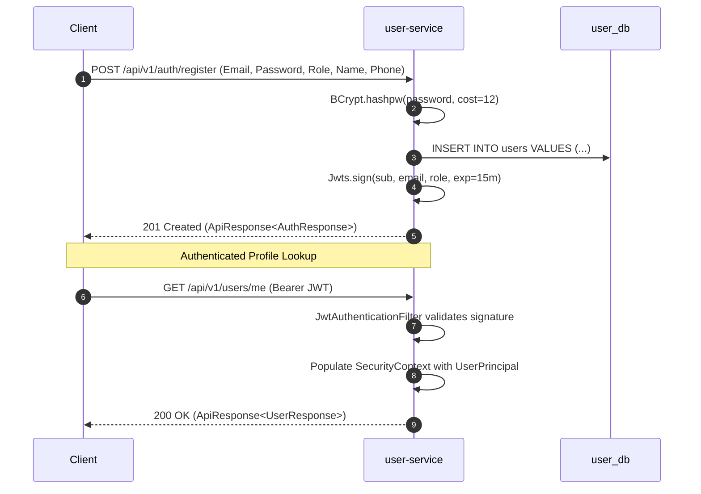

# Stage 1 - Increment 1.1: Identity, Password Hashing & Stateless JWT Authentication

**Date:** 2026-10-30  
**Status:** Complete  
**Service:** `services/user-service` (Port `8081`, Database `user_db`)  
**Branch:** `feat/stage-1-core-domain`  

---

## 1. Overview & Problem Solved
To support distributed microservices without a shared database or stateful session store, we implemented **Stateless JWT Authentication with Role-Based Access Control (RBAC)** in `user-service`.

Clients authenticate with email and password. Once verified against salted BCrypt hashes, `user-service` issues a cryptographically signed HMAC-SHA256 JWT containing identity and role claims. Downstream microservices (`catalog-service`, `order-service`) can verify token authenticity in microseconds with zero database hits.

---

## 2. Implemented Architecture



---

## 3. Key Components Implemented

| Component | File Path | Responsibility |
| :--- | :--- | :--- |
| **`User` Entity** | [`User.java`](file:///Users/adil/Desktop/project-backend-2/services/user-service/src/main/java/com/swiggy/user/model/User.java) | JPA entity mapped to Flyway `users` table in `user_db`. |
| **`UserRole`** | [`UserRole.java`](file:///Users/adil/Desktop/project-backend-2/services/user-service/src/main/java/com/swiggy/user/model/UserRole.java) | Enum: `CUSTOMER`, `RESTAURANT_OWNER`, `RIDER`, `ADMIN`. |
| **`UserRepository`** | [`UserRepository.java`](file:///Users/adil/Desktop/project-backend-2/services/user-service/src/main/java/com/swiggy/user/repository/UserRepository.java) | Spring Data JPA repository for case-insensitive email queries. |
| **`JwtService`** | [`JwtService.java`](file:///Users/adil/Desktop/project-backend-2/services/user-service/src/main/java/com/swiggy/user/security/JwtService.java) | HMAC-SHA256 signing, claims extraction, expiration checking. |
| **`JwtAuthFilter`** | [`JwtAuthenticationFilter.java`](file:///Users/adil/Desktop/project-backend-2/services/user-service/src/main/java/com/swiggy/user/security/JwtAuthenticationFilter.java) | Intercepts requests, extracts Bearer token, populates `SecurityContext`. |
| **`SecurityConfig`** | [`SecurityConfig.java`](file:///Users/adil/Desktop/project-backend-2/services/user-service/src/main/java/com/swiggy/user/security/SecurityConfig.java) | Stateless session policy, CSRF disabled, BCryptPasswordEncoder(12). |
| **`AuthService`** | [`AuthService.java`](file:///Users/adil/Desktop/project-backend-2/services/user-service/src/main/java/com/swiggy/user/service/AuthService.java) | Registration, credential check, profile lookup. |
| **`AuthController`** | [`AuthController.java`](file:///Users/adil/Desktop/project-backend-2/services/user-service/src/main/java/com/swiggy/user/controller/AuthController.java) | Public endpoints: `POST /api/v1/auth/register`, `POST /api/v1/auth/login`. |
| **`UserController`** | [`UserController.java`](file:///Users/adil/Desktop/project-backend-2/services/user-service/src/main/java/com/swiggy/user/controller/UserController.java) | Authenticated endpoint: `GET /api/v1/users/me`. |

---

## 4. Architectural Decisions Recorded

* **[ADR-003: Stateless JWT Authentication with RBAC](file:///Users/adil/Desktop/project-backend-2/docs/adr/ADR-003-stateless-jwt-authentication.md):**
  - Chose stateless JWT (HS256) over stateful server sessions to eliminate authentication DB bottlenecks.
  - Work factor 12 for BCrypt password hashing.
  - 15-minute access token lifespan.
  - Uniform `INVALID_CREDENTIALS` error code to prevent user enumeration attacks.

---

## 5. Test Suite Verification (Testcontainers + PostgreSQL 16)

8 integration tests implemented in [`AuthControllerIntegrationTests.java`](file:///Users/adil/Desktop/project-backend-2/services/user-service/src/test/java/com/swiggy/user/controller/AuthControllerIntegrationTests.java):
* `shouldRegisterUserAndReturnJwtToken`: Verifies password hash `$2a$12$...` in Postgres and JWT issuance.
* `shouldFailRegistrationWhenEmailAlreadyExists`: Asserts `409 Conflict` on duplicate emails.
* `shouldRejectInvalidRegistrationPayload`: Asserts `400 Bad Request` on Bean Validation violations.
* `shouldLoginSuccessfullyWithValidCredentials`: Asserts login returns valid JWT token.
* `shouldRejectLoginWithIncorrectPassword`: Asserts wrong password returns `401 Unauthorized`.
* `shouldAccessProtectedEndpointWithValidJwt`: Asserts Bearer token permits access to `/api/v1/users/me`.
* `shouldRejectProtectedEndpointWithoutJwt`: Asserts missing token returns `403 Forbidden`.

Run verification:
```bash
./gradlew :services:user-service:test
```
