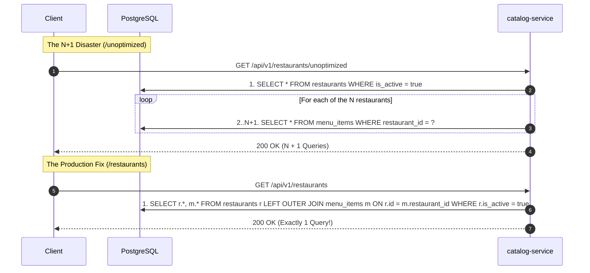

# Stage 1 - Increment 1.2: Restaurant Catalog & The Infamous N+1 Query Fix

**Date:** 2026-10-30  
**Status:** Complete  
**Service:** `services/catalog-service` (Port `8082`, Database `catalog_db`)  
**Branch:** `feat/stage-1-core-domain`  

---

## 1. Overview & Problem Solved
When customers browse restaurant catalogs, applications frequently need to load both the restaurant metadata and its list of menu items.

Under naive JPA implementations (`@OneToMany(fetch = FetchType.LAZY)` with `findAll()`), the application suffers from the **N+1 query problem**:
- 1 initial query loads $N$ restaurants: `SELECT * FROM restaurants WHERE is_active = true;`
- $N$ additional queries execute as the code iterates through each restaurant's items: `SELECT * FROM menu_items WHERE restaurant_id = ?;`
- For 50 restaurants, this executes $1 + 50 = 51$ round-trips to PostgreSQL, draining connection pools and causing high latency.

In this increment, we modeled the catalog domain, built both the unoptimized demonstration query and the production-grade fix using **JPA `@EntityGraph`**, and verified that it collapses the query count to **exactly 1 single SQL query**.

---

## 2. Architecture: N+1 Trap vs. Production Fix



---

## 3. Key Components Implemented

| Component | File Path | Responsibility |
| :--- | :--- | :--- |
| **`Restaurant` Entity** | [`Restaurant.java`](file:///Users/adil/Desktop/project-backend-2/services/catalog-service/src/main/java/com/swiggy/catalog/model/Restaurant.java) | JPA entity with bidirectional `@OneToMany` to `MenuItem` (Lazy). |
| **`MenuItem` Entity** | [`MenuItem.java`](file:///Users/adil/Desktop/project-backend-2/services/catalog-service/src/main/java/com/swiggy/catalog/model/MenuItem.java) | Menu items with price stored in integer cents. |
| **`RestaurantRepository`** | [`RestaurantRepository.java`](file:///Users/adil/Desktop/project-backend-2/services/catalog-service/src/main/java/com/swiggy/catalog/repository/RestaurantRepository.java) | Contains both `findByIsActiveTrue()` (N+1) and `@EntityGraph` optimized query. |
| **`RestaurantService`** | [`RestaurantService.java`](file:///Users/adil/Desktop/project-backend-2/services/catalog-service/src/main/java/com/swiggy/catalog/service/RestaurantService.java) | CRUD logic, unoptimized vs. optimized query methods, paginated search. |
| **`RestaurantController`** | [`RestaurantController.java`](file:///Users/adil/Desktop/project-backend-2/services/catalog-service/src/main/java/com/swiggy/catalog/controller/RestaurantController.java) | Exposes `/unoptimized`, `/restaurants`, and `/search`. |

---

## 4. Architectural Decisions Recorded

* **[ADR-004: JPA Query Optimization and N+1 Prevention](file:///Users/adil/Desktop/project-backend-2/docs/adr/ADR-004-jpa-query-optimization-and-n-plus-1-prevention.md):**
  - Chose `@EntityGraph(attributePaths = {"menuItems"})` over `FetchType.EAGER` to avoid permanent memory bloat.
  - Kept OSIV disabled (`open-in-view: false`).
  - Stored currency in smallest integer unit (`price_cents`).

---

## 5. Test Suite Verification (Testcontainers + PostgreSQL 16)

Integration tests in [`RestaurantQueryPerformanceTests.java`](file:///Users/adil/Desktop/project-backend-2/services/catalog-service/src/test/java/com/swiggy/catalog/RestaurantQueryPerformanceTests.java):
* `shouldExecuteUnoptimizedQuery`: Demonstrates N+1 query lazy loading for 5 restaurants and 15 items.
* `shouldExecuteOptimizedEntityGraphQuery`: Asserts `@EntityGraph` query returns identical data graph in 1 query.
* `shouldReturnPaginatedSearchResults`: Asserts pagination (`Pageable`, page, size, totalElements) limits DB extraction.
* `shouldCreateRestaurantAndAddMenuItem`: Asserts REST creation and PostgreSQL persistence.

Run verification:
```bash
./gradlew :services:catalog-service:test
```
