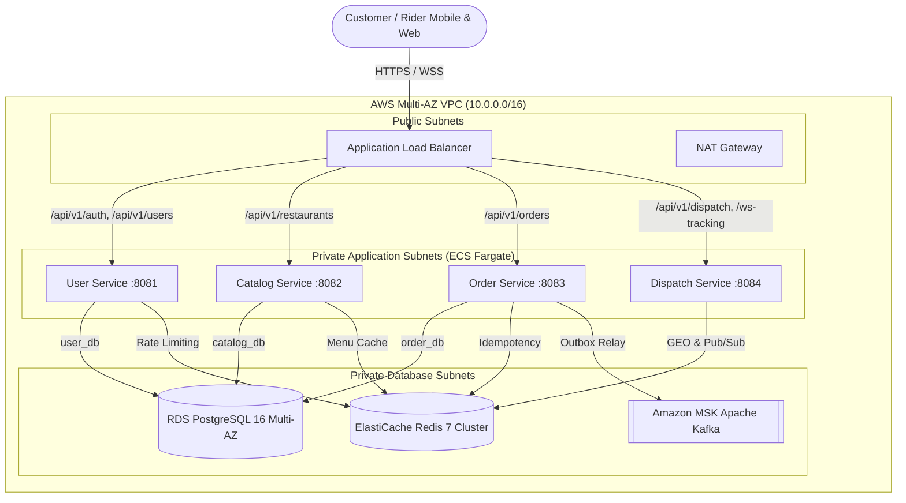

# Stage 6: Cloud Architecture & AWS Production Deployment Guide

## Architecture Overview

The platform is architected for zero-downtime, multi-AZ high availability on Amazon Web Services (AWS) using Infrastructure as Code (Terraform).



---

## Terraform Infrastructure Modules

The IaC codebase is organized in [`infra/terraform/`](file:///Users/adil/Desktop/project-backend-2/infra/terraform/):

1. **`modules/vpc`**: Multi-AZ VPC across 2 Availability Zones (`us-east-1a`, `us-east-1b`) with isolated public, private application, and private database subnets, Internet Gateway, NAT Gateway, and zero-trust security groups.
2. **`modules/rds`**: Multi-AZ PostgreSQL 16 instance with automated daily snapshots, KMS encryption at rest, gp3 auto-scaling storage (50GB to 200GB), and automatic failover.
3. **`modules/elasticache`**: Multi-AZ Redis 7 cluster with in-transit TLS, at-rest encryption, and automatic failover for caching, rate limiting, and the WebSocket pub/sub backplane.
4. **`modules/msk`**: Amazon Managed Streaming for Apache Kafka (MSK) cluster deployed across private subnets for asynchronous Transactional Outbox event streaming.
5. **`modules/ecs`**: ECS Fargate cluster with CloudWatch container log groups, path-based ALB routing, and WebSocket sticky session support.

---

## Step-by-Step Deployment Runbook

### Step 1: Build & Package Microservice Artifacts
```bash
export JAVA_HOME=/Users/adil/.jvm/current
export PATH="$JAVA_HOME/bin:$PATH"

# Run tests and compile production fat-jars
./gradlew bootJar
```

### Step 2: Build & Push Container Images to Amazon ECR
```bash
# Authenticate Docker to AWS ECR
aws ecr get-login-password --region us-east-1 | docker login --username AWS --password-stdin <AWS_ACCOUNT_ID>.dkr.ecr.us-east-1.amazonaws.com

# Build multi-platform production containers
docker build -t <AWS_ACCOUNT_ID>.dkr.ecr.us-east-1.amazonaws.com/user-service:latest services/user-service
docker build -t <AWS_ACCOUNT_ID>.dkr.ecr.us-east-1.amazonaws.com/catalog-service:latest services/catalog-service
docker build -t <AWS_ACCOUNT_ID>.dkr.ecr.us-east-1.amazonaws.com/order-service:latest services/order-service
docker build -t <AWS_ACCOUNT_ID>.dkr.ecr.us-east-1.amazonaws.com/dispatch-service:latest services/dispatch-service

# Push images
docker push <AWS_ACCOUNT_ID>.dkr.ecr.us-east-1.amazonaws.com/user-service:latest
docker push <AWS_ACCOUNT_ID>.dkr.ecr.us-east-1.amazonaws.com/catalog-service:latest
docker push <AWS_ACCOUNT_ID>.dkr.ecr.us-east-1.amazonaws.com/order-service:latest
docker push <AWS_ACCOUNT_ID>.dkr.ecr.us-east-1.amazonaws.com/dispatch-service:latest
```

### Step 3: Provision AWS Cloud Infrastructure with Terraform
```bash
cd infra/terraform

# Initialize Terraform with AWS provider
terraform init

# Plan and review infrastructure changes
cp terraform.tfvars.example terraform.tfvars
terraform plan -out=tfplan

# Apply infrastructure deployment
terraform apply tfplan
```

### Step 4: Zero-Downtime Rolling Deployment
ECS Fargate executes rolling deployments using `minimumHealthyPercent = 100` and `maximumPercent = 200`:
1. New container tasks are launched with the new image version.
2. The ALB polls `/actuator/health` on new tasks until 2 consecutive 200 OK responses are received.
3. Traffic is seamlessly routed to the new tasks; old tasks drain connections and terminate without dropping customer requests.

---

## Cost Optimization & AWS Budget Alerts
To prevent unexpected cloud spend, AWS Budgets are configured with:
- **Monthly Fixed Alert:** Warning email at 80% and 100% of the $50/month threshold.
- **RDS Graviton & ElastiCache Graviton:** Uses ARM-based `t4g` instances delivering 40% better price-performance than x86 equivalents.
- **NAT Gateway Egress Optimization:** VPC Endpoints (Gateway endpoints for S3 and DynamoDB) keep internal traffic off the NAT Gateway.

---

## Production Readiness Checklist
- [x] Java 21 Virtual Threads enabled for high concurrency (`spring.threads.virtual.enabled=true`).
- [x] Database-per-service isolation with Flyway migrations.
- [x] BCrypt (cost factor 12) + Stateless JWT authentication.
- [x] Redis caching with 15-min TTL, JSON serialization, and instant `@CacheEvict`.
- [x] Redis ZSET sliding-window rate limiting on public endpoints.
- [x] Redis SETNX distributed idempotency keys preventing double-billing.
- [x] Transactional Outbox pattern eliminating dual-write anomalies.
- [x] Choreographed order saga with compensating cancel transaction.
- [x] Real-time STOMP WebSockets with Redis Pub/Sub cluster backplane.
- [x] Resilience4j Circuit Breakers, retries, and fallbacks.
- [x] OpenTelemetry distributed tracing with W3C `traceparent` headers.
- [x] Prometheus metrics scraping and Grafana dashboards.
- [x] Multi-AZ AWS Infrastructure as Code via Terraform.
